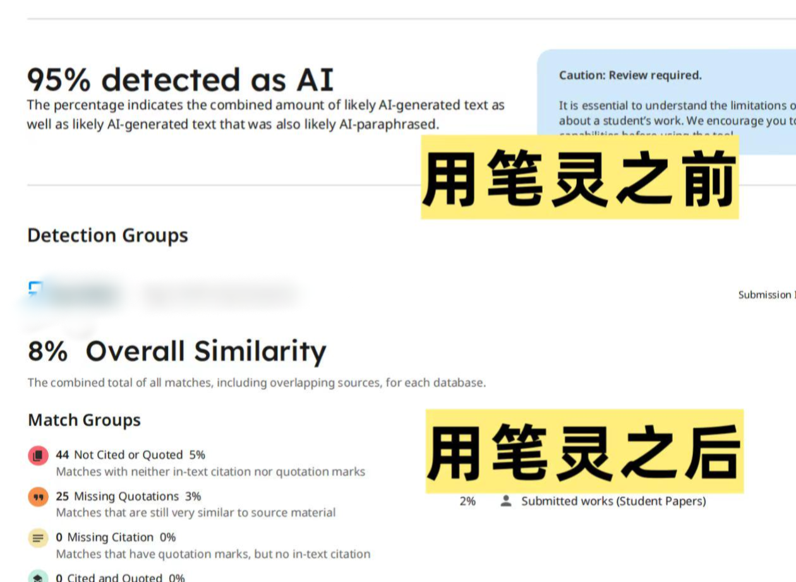
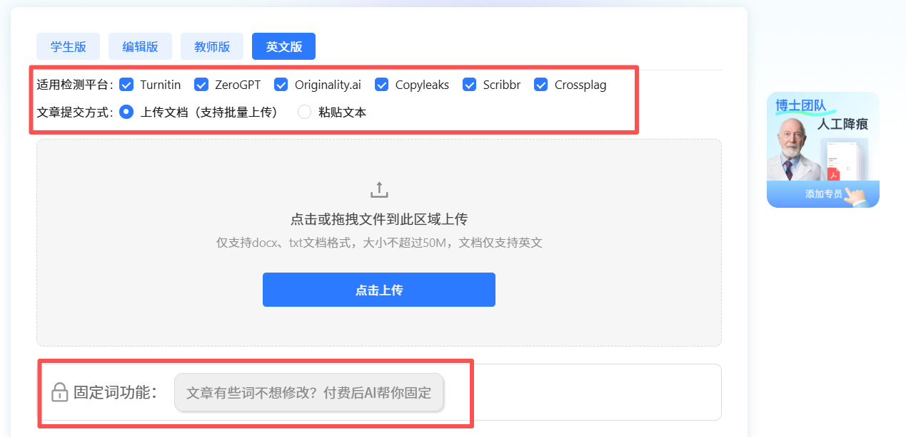
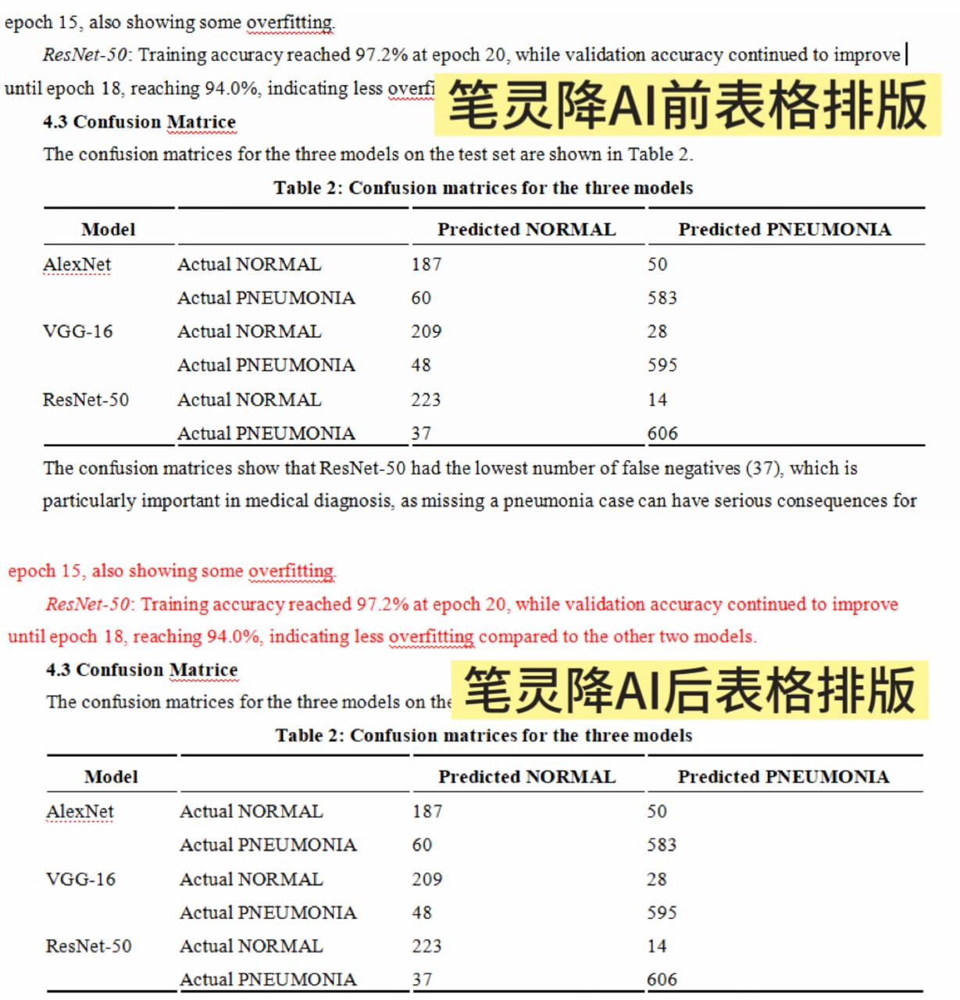
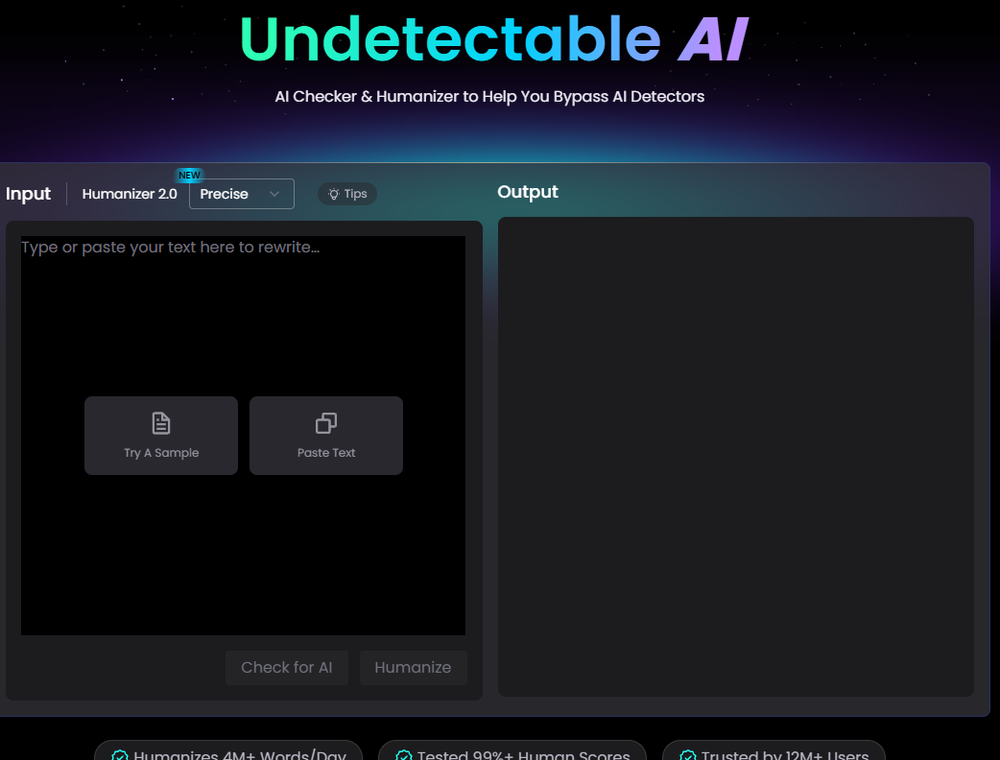
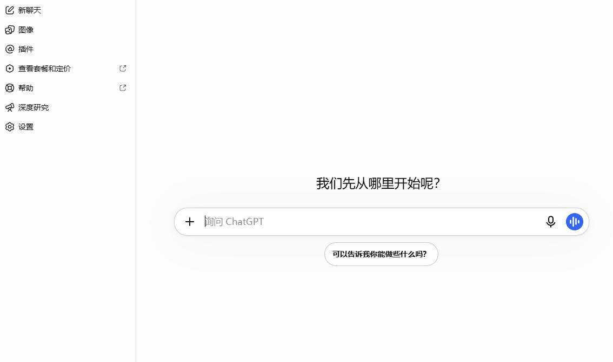

# 2026最新盘点：6款英文降ai率工具实测合集！一篇搞定AIGC降重

明明框架和观点都是自己构思，只是用AI辅助拓展内容，检测的时候AI占比却居高不下？

我们单纯替换同义词做改写，很容易破坏专业术语、打乱原文逻辑，检测容易出问题，想做好**英文降ai**，选对适配自己稿件的工具，远比盲目改写重要。

我这段时间实测多款主打英文改写的工具，区分深度改写、润色校对、文本核验三大方向，兼顾付费工具和**英文免费降ai率工具**。

如果你需要做**英文aigc免费降重**，或者想寻找靠谱方案，甚至是在观望有没有好用的方法，这篇测评都可以作为参考。

# **一、深度改写类（重构句式，大幅弱化AI行文特征）**

适合：AI标记极高的英文初稿，核心目标是进行专业的**英文降ai率**处理，打散固定句式结构，保留核心信息与专业术语。

## **1、笔灵英文降AI**

**官网：**[https://u\.ibiling\.cn](https://ibiling.cn/paper-pass/english?from=githubywjiangai1009jw)（网页版打开体验更佳）

**优势**：国内可直接访问的**英文降ai率工具**，也是我这次在**英文ai降ai**的实测中稳定性比较突出的一款，我拿多类英文文档测试，高AI标记稿件经过深度改写之后，AI检测数值回落效果还是比较稳定的。

首先它是支持docx、txt文档批量上传的，万字长文档一次性导入处理，参考文献、公式标注、专业名词可以设置锁定不改动，这样修改效率会比较高。

而且排版也可以保留，这一点我很喜欢， 国内访问速度非常稳定，不需要特殊网络环境，批量处理稿件效率更高。

**局限性**：部分极小众领域的冷门专业词汇，偶尔会出现释义偏差，改写结束后需要人工核对一遍核心术语。

**适合人群**：有英文文稿处理需求，需要批量处理稿件、追求稳定**英文降ai率**效果的小伙伴。

## **2、Undetectable AI**

**官网**：[https://undetectableai\.ai/](https://undetectableai.ai/)

**优势**：海外专门做英文降ai改写的工具，内置多种文风模板，文章、博客、报告风格可以切换，改写时会主动打乱AI惯用句式，在海外多款AI检测器下表现不错。

**局限性**：免费额度极少且易破坏原排版。对中文语境稿件适配一般，改写偶尔偏离原意，无法像笔灵那样精准锁定专业术语。

**适合人群**：有稳定外网，短文英文内容、海外自媒体文案改写需求。

# **二、润色校对类（优化语句地道度，辅助降低AI标记）**

适合：原稿原创度较高、AI标记不算严重，重点优化语法、语句流畅度。

## **3、Grammarly**

**官网**：[https://www\.grammarly\.com/](https://www.grammarly.com/)

**优势**：大家很熟悉的英文校对工具，语法、时态、介词、句式冗余问题识别精准，润色出来的文本贴近母语写作习惯。可以搭配改写工具一起使用，用来收尾打磨文稿，辅助**降低英文ai**的识别风险。

**局限性**：核心定位是语法校对，不具备强改写能力，AI标记严重的稿件只靠它很难实现降标。免费版功能有限，高级润色需要会员。

**适合人群**：稿件基础较好，只需要校对语法、优化表达细节的创作者。

## **4、Linguix**

**官网**：[https://linguix\.com/](https://linguix.com/)

**优势**：支持句式改写加语法纠错一体，单句可以给出多版改写方案，改写风格偏简洁学术风，适合逐段微调英文句子，慢慢打散AI模板化表达，这个有免费额度可以用来测试，适合尝试**英文免费降ai率**。

**局限性**：不支持超大文档批量一键改写，只适合分段处理，大批量稿件操作起来耗时。

**适合人群**：愿意手动微调、短文精细化修改，做英文AIGC免费降重测试的用户。

# **三、文本核验筛查类（定位高风险段落，提前排查，辅助改写规划）**

适合：先通读全文，快速找出AI痕迹重的段落，标记出来重点修改，不适合直接定稿改写。

## **5、ChatGPT**

**官网**：[https://chat\.openai\.com/](https://chat.openai.com/)

**优势**：长文本理解能力强，可以让它帮你通读英文稿件，标出AI感很重的句子，同时给出多版改写思路，灵活性高。

**局限性**：极度消耗时间精力，作为非专业降AI工具，需要反复调教且效果极不稳定；改写后很容易被二次精准捕获，只能做前期初筛，无法直接作为终稿兜底。

**适合人群**：时间充裕、仅需批量初筛找出高危段落，后续能搭配笔灵等专业工具进行深度精修兜底的用户。

## **6、SpinBot**

**官网**：[https://spinbot\.com/](https://spinbot.com/)

**优势**：免费无注册即可使用，上手零门槛，适合短段落快速测试改写效果，想低成本试一下**英文AIGC免费降重**。

**局限性**：改写偏向粗暴同义词替换，逻辑断裂、语句不通的情况很常见，正式英文稿件不建议直接使用改写结果。AI检测严格的平台下，降标效果很差。

**适合人群**：少量短句测试，不用于正式稿件提交。

# **四、实测搭配方案**

如果想要稳妥拿到不错的降标效果，最佳的流程是：先用免费大模型通读稿件，批量初筛并标记出AI痕迹偏重的高危段落；随后将稿件导入笔灵对全文做深度精修与格式兜底，锁定参考文献与专业名词；完成改写后，用Grammarly校对语句、修正细节语法。所有工具辅助完成后，务必通读人工确认。

# **手动实操小技巧**

1、混合长短句：AI生成内容句式节奏往往高度一致，手动拆分长句、合并短句，打破固定行文节奏。

2、加入个性化解读：在论述部分补充自己的分析、对比想法，独有的观点内容很难被判定为AIGC。

3、灵活切换主动语态、被动语态，避免全文语态统一。

4、改写修饰成分，核心专业名词保留不变，修改名词前后的描述短语。

